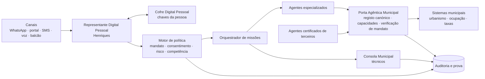
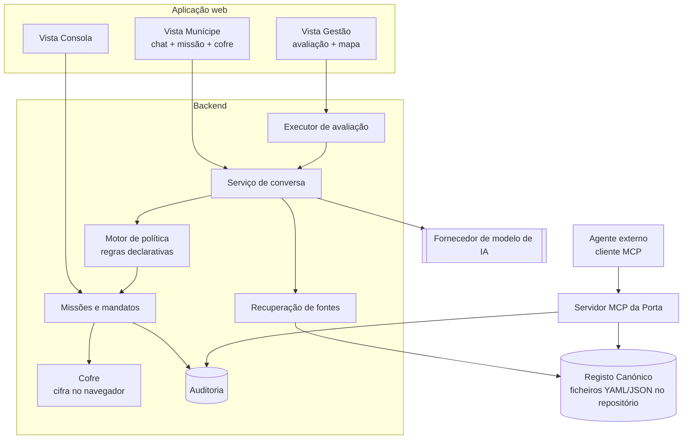
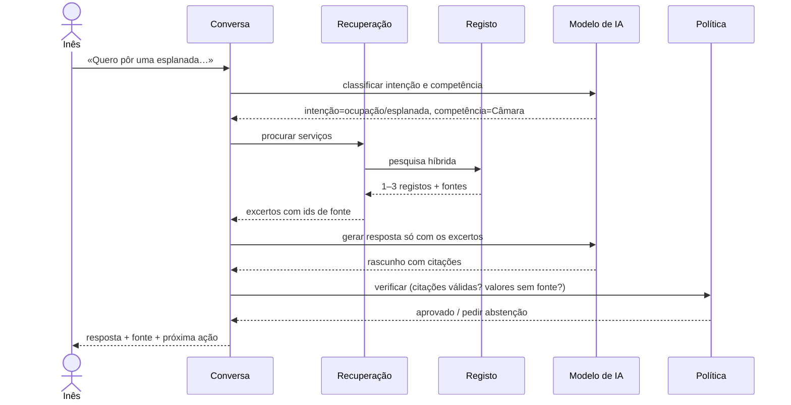
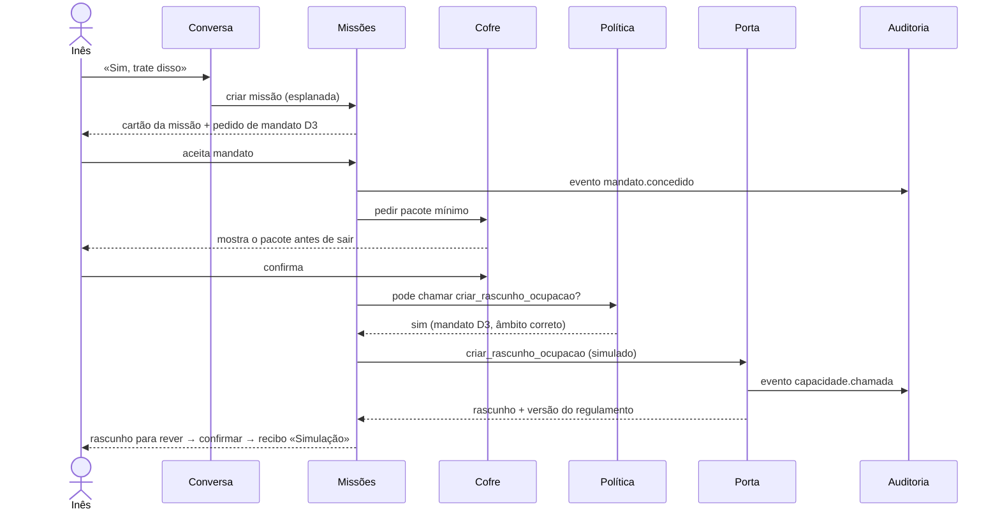

# 10 · Arquitetura

> Estado: versão de trabalho · Atualizado: 18/10/2026 · [Índice](README.md)

## 1. Arquitetura-alvo (R1+)



### Responsabilidades

| Componente | Responsabilidade | Não faz |
|---|---|---|
| Canais | Receber e entregar mensagens; abrir vistas seguras | Guardar dados do Cofre |
| Representante | Conversar, entender missões, formatar respostas | Aceder diretamente a sistemas |
| Cofre | Guardar itens cifrados; produzir pacotes mínimos | Expor conteúdo ao operador |
| Motor de política | Decidir se uma ação é permitida, pedida a confirmação ou bloqueada | Executar ações |
| Orquestrador | Dividir a missão por agentes, gerir estados | Ignorar o motor de política |
| Agentes especializados | Tarefas delimitadas (ver [12](12-ia-e-avaliacao.md)) | Usar ferramentas fora da sua lista |
| Porta Agêntica | Expor serviços e capacidades com verificação de mandato e auditoria | Dar acesso geral a bases de dados |
| Consola | Apresentar casos a técnicos e registar decisões | Decidir sozinha |
| Auditoria | Registo só de acréscimo de todos os eventos relevantes | Ser editável |

## 2. Arquitetura do protótipo (R0)

Objetivo: o mínimo que demonstra a arquitetura-alvo, construído em 5 dias, com fontes públicas reais.



### 2.1 Stack recomendada

> Decisão final da equipa no dia 1 ([ADR-008](21-registo-de-decisoes.md#adr-008)). Critério: o que a equipa domina melhor.

| Camada | Recomendação | Alternativa |
|---|---|---|
| Interface | Next.js + TypeScript + Tailwind | SvelteKit |
| Backend | Rotas API do Next.js (mesmo repositório) | Python + FastAPI |
| Registo Canónico | Ficheiros YAML no repositório, validados por esquema JSON | SQLite |
| Recuperação | Pesquisa híbrida: palavras-chave (BM25) + embeddings sobre os registos | Só palavras-chave, dado o catálogo pequeno |
| Modelo de IA | Família Claude 5 (modelo maior para conversa e juiz da avaliação, modelo menor para classificação) | Outro fornecedor, por configuração |
| Porta Agêntica | Servidor MCP em TypeScript (SDK oficial) + endpoints REST equivalentes | Python (SDK oficial) |
| Cofre | Cifra no navegador (Web Crypto, AES-GCM) com chave derivada localmente | Cifra no servidor (só para demo) |
| Auditoria | Tabela só de acréscimo (SQLite / Postgres) com encadeamento por hash | Ficheiro JSONL |
| Alojamento | Vercel / Fly.io / Render (região UE) | Máquina local + túnel como plano B |
| WhatsApp (C) | Sandbox de fornecedor de WhatsApp Business | Não fazer em R0 |

Todas as ferramentas e modelos são identificados no README e na submissão (regra do hackathon).

### 2.2 Estrutura do repositório

```text
delegate/
├── README.md                 # o que é, como correr, créditos, licença
├── LICENSE                   # EUPL-1.2
├── registo/                  # Registo Canónico (1 ficheiro por serviço)
│   ├── _schema.json
│   └── ocupacao-espaco-publico-esplanada.yaml
├── avaliacao/
│   ├── conjunto.yaml         # anexo B
│   └── resultados/           # uma pasta por execução
├── app/                      # interface e API
├── porta/                    # servidor MCP + REST
├── politica/                 # regras do motor de política
└── docs/                     # ligação a /specs
```

## 3. Fluxos principais

### 3.1 Pergunta com resposta e fonte (HU-01)



### 3.2 Missão com mandato (HU-06 a HU-10)



## 4. Integrações por release

| Sistema | R0 | R1 | R2+ |
|---|---|---|---|
| Diretório de Serviços, Formulários, Regulamentos (páginas públicas) | Leitura manual e curadoria | Monitorização de alterações | Fonte validada pela Câmara |
| Urbanismo Digital | Não | Leitura de estado (se houver interface autorizada) | Rascunhos |
| Serviços Online | Não | Leitura de estado (idem) | Submissão de baixo risco |
| Chave Móvel Digital | Simulada | Autenticação e assinatura | Idem |
| Atendedor virtual atual | Não | Possível consumidor da Porta | Idem |
| WebSIG / PDM | Ligações | Camadas para o gémeo dos ativos | Idem |
| iAP / EUDI Wallet | Não | Não | R3–R4 |

## 5. Decisões de arquitetura relevantes

Ver [21](21-registo-de-decisoes.md): ADR-006 (só dados públicos), ADR-007 (chat web em R0), ADR-008 (stack), ADR-009 (registo em ficheiros versionados), ADR-010 (Porta em MCP).
