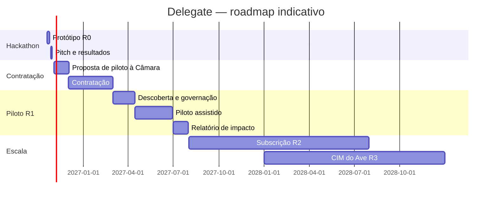

# 17 · Entrada no mercado e roadmap

> Estado: versão de trabalho · Atualizado: 18/10/2026 · [Índice](README.md)

## 1. Roadmap

Datas depois do hackathon são indicativas e dependem da contratação.

## 2. Fases

| Fase | Duração | Via de contratação | Resultado verificável |
|---|---|---|---|
| R0 · Hackathon | 19–28/10/2026 | — | Protótipo, avaliação, prémio |
| Proposta | Novembro 2026 | — | Proposta técnica e financeira entregue |
| R1 · Descoberta e governação | 6–8 semanas | Ajuste direto ⚠️ ou parceria para a inovação | Jornadas priorizadas, donos de conteúdo, AIPD, linha de base |
| R1 · Piloto assistido | 8–12 semanas | Idem | 100–300 munícipes, Consola em uso, métricas |
| R2 · Transação controlada | 3–6 meses | Subscrição (concurso público) | CMD, recibos, uma ação formal de baixo risco |
| R2 · Escala municipal | Contínua | Subscrição | 10+ capacidades |
| R3 · Rede intermunicipal | Anos 2–3 | Acordo-quadro CIM do Ave | Conectores reutilizados |
| R3 · Agentes certificados | Ano 3 | Contratos com privados | Parceiro âncora em produção |
| R4 · Federação | Depois | Parcerias nacionais e europeias | Protocolo adotado por outras entidades |

## 3. Plano de 30 dias após o hackathon

| Semana | Ação | Dono |
|---|---|---|
| 29/10–01/11 | Retrospetiva; publicar a avaliação e o código; agradecer mentores | [nome] |
| 02–08/11 | Pedir reunião à Divisão de Atendimento e ao vereador da modernização | [nome] |
| 02–15/11 | Enviar pedido de dados agregados à Câmara (secção 4) | [nome] |
| 09–22/11 | Preparar proposta de piloto (C1) com plano, preço e AIPD inicial | [nome] |
| até 30/11 | Entregar proposta | [nome] |

## 4. Pedido de dados agregados à Câmara

Baseado no [dossiê, secção 13](../reference-docs/Camara_Municipal_de_Guimaraes_Servicos_e_Indicadores_2025.md). Dados **anonimizados e agregados**, 2025–2026, por mês, procedimento e canal:

1. Os 20 procedimentos mais iniciados em 2025, por pedidos distintos.
2. Os 5 temas mais frequentes das chamadas e emails.
3. Procedimentos com mais pedidos de correção documental e recontactos.
4. Taxonomia interna de assuntos do BUA e dos Serviços Online.
5. Interfaces técnicas existentes para consulta de estado de processos.
6. Métricas do atendedor virtual com IA.
7. Departamentos disponíveis para validar conteúdo e casos de teste.
8. Possibilidade de dados históricos em CSV/JSON com definições.

## 5. Parceiros

| Parceiro | Papel | Quando |
|---|---|---|
| Câmara Municipal de Guimarães | Cliente do piloto; dono do conteúdo | R1 |
| DTx e CCG/ZGDV | Mentoria; possível parceria técnica e de investigação | R0–R1 |
| Fornecedor do atendedor virtual atual | Consumidor da Porta | R1–R2 |
| CIM do Ave | Acordo-quadro | R3 |
| AMA | Interoperabilidade (iAP), CMD, possível adoção nacional | R2–R4 |
| Fabricante de software de contabilidade | Parceiro âncora para agentes certificados | R3 |
| Juntas de Freguesia | Representantes humanos; Espaços Cidadão | R1 |

## 6. Financiamento

| Fonte | Uso | Estado |
|---|---|---|
| Prémio do hackathon (até 8.500 €: desafio + 1.º lugar) | Manter a equipa até à proposta | 🧪 |
| Contrato de piloto (C1) | Piloto | 🧪 |
| Fundos de modernização administrativa e transição digital (Portugal 2030, PRR, programas europeus) | Cofinanciar piloto e escala | ⚠️ confirmar avisos abertos |
| Candidatura de Guimarães a Cidade Europeia da Inovação | Visibilidade e possível enquadramento | ⚠️ |

## 7. Mensagens por público

| Público | Mensagem |
|---|---|
| Executivo municipal | «Guimarães, a primeira câmara pronta para agentes de IA, com controlo humano e fonte em cada resposta.» |
| Divisão de Atendimento | «Pedidos completos à primeira e menos chamadas a perguntar o estado, medidos contra uma linha de base.» |
| Técnicos | «Casos preparados. A decisão continua a ser sua.» |
| Munícipes | «Diga o que precisa. O Henriques trata do resto.» |
| Parceiros privados | «Uma porta governada para tratar da Câmara pelos seus clientes.» |
