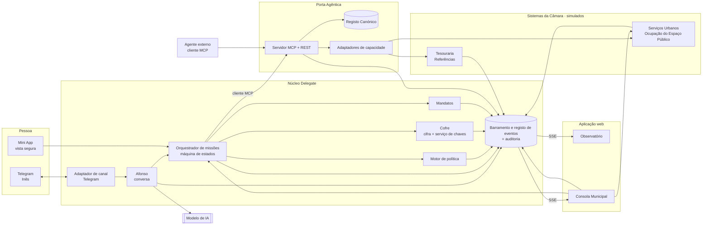
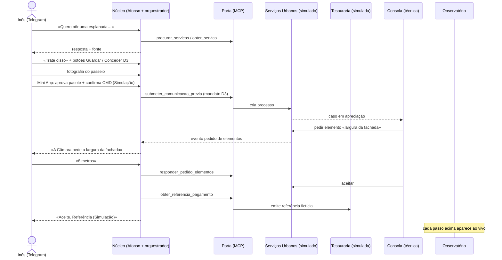

# 02 · Arquitetura da demo

> Estado: proposta para discussão · Atualizado: 18/10/2026 · [Estratégia](README.md)
> Complementa [10 · Arquitetura](../10-arquitetura.md). Onde houver diferença, este documento descreve o protótipo R0.

## 1. Visão de componentes



## 2. Implementáveis

Três serviços, para equilibrar fiabilidade e uma arquitetura visível:

| Implementável | Contém | Porquê separado |
|---|---|---|
| **núcleo** | Adaptador Telegram, Afonso, orquestrador, política, Cofre, mandatos, barramento de eventos (SSE) | Um só processo reduz falhas de rede na demo |
| **porta** | Servidor MCP/REST, Registo Canónico, adaptadores, **e os dois sistemas simulados** (rotas separadas, base de dados separada) | A fronteira de rede entre núcleo e Porta é real: o Afonso usa a Porta como um terceiro |
| **web** | Observatório, Consola, Mini App, página da Porta | Interface independente; lê eventos por SSE |

Base de dados: uma instância Postgres com esquemas separados (`nucleo`, `porta`, `su_simulado`, `tesouraria_simulada`). Alternativa para a máquina local: SQLite por serviço.

## 3. Decisões técnicas

| Decisão | Escolha | Razão |
|---|---|---|
| Linguagem | TypeScript em todo o monorepositório | Um só ecossistema para bot, MCP e web; tipos partilhados do contrato de eventos |
| Bot | grammY (Telegram), *long polling* | Simples; funciona sem URL pública; plano B local |
| Orquestração | **Máquina de estados explícita** (ex.: XState ou código simples) com o modelo de IA em passos delimitados | Previsível, rápida, cada passo é um evento legível |
| Modelo de IA | Família Claude 5: modelo menor para classificação, maior para redação e verificação | Identificar na submissão |
| Porta | SDK oficial MCP (TypeScript) com transporte HTTP + REST espelhado | O Afonso e agentes externos usam o mesmo caminho |
| Eventos | Tabela `eventos` só de acréscimo + `LISTEN/NOTIFY` → SSE | O registo de eventos é a auditoria; sem broker extra |
| Web | Next.js + React; React Flow para o grafo; Framer Motion para animações | Rápido de construir; boa qualidade visual |
| Cofre | Cifra AES-GCM por pessoa; **serviço de chaves** interno que só liberta a chave com mandato válido e missão ativa, por prazo | Demonstra «o operador não lê»; ver secção 5 |
| Alojamento | Região UE (Fly.io, Render ou Railway) + versão local completa | Plano B |

## 4. Orquestração: passos com IA e sem IA

O júri vê «agentes»; o código tem passos com responsabilidades claras.

| Passo (agente no Observatório) | Usa IA? | Evento |
|---|---|---|
| Entendimento de missão | Sim (modelo menor): intenção, competência, categoria, confiança | `afonso.intencao.classificada` |
| Navegador de regras | Não (chamada MCP `procurar_servicos` + `obter_servico`) | `porta.servicos.procurados`, `porta.servico.obtido` |
| Redator | Sim (modelo maior), só com os excertos | `afonso.resposta.redigida` |
| Verificador | Regras + IA: citações existem? números estão nos excertos? | `afonso.resposta.verificada` / `afonso.resposta.abstencao` |
| Guardião de contexto | Não: seleciona itens do Cofre pela finalidade | `cofre.pacote.preparado` |
| Supervisor de risco | Não: motor de política declarativo | `politica.decisao` |
| Construtor de jornada | Não: checklist a partir do registo | `missao.checklist.gerada` |
| Integração | Não: chamadas MCP às capacidades | `porta.capacidade.chamada` |

Meta de latência por resposta informativa: p95 ≤ 8 s. O bot mostra «a escrever…» enquanto processa.

## 5. Cofre: como mostrar que o operador não lê

```text
Inês aceita guardar → conteúdo cifrado com a chave da Inês → só metadados em claro
Missão autorizada (mandato D3 + confirmação) → serviço de chaves liberta a chave
  → para a missão MIS-0007, durante 10 minutos → evento cofre.chave.libertada
Guardião de contexto lê só os campos da finalidade → pacote mínimo → Inês aprova na Mini App
Prazo termina ou missão fecha → evento cofre.chave.recolhida
```

Em R0 o serviço de chaves é um módulo interno que simula um HSM. É uma simplificação honesta, a declarar no modo técnico. Em R1, a chave fica do lado da pessoa.

## 6. Fluxo completo da missão da esplanada



## 7. Estrutura do repositório

```text
delegate/
├── apps/
│   ├── nucleo/           # bot, Afonso, orquestrador, política, cofre, eventos
│   ├── porta/            # MCP + REST, adaptadores, sistemas simulados
│   └── web/              # Observatório, Consola, Mini App, página da Porta
├── packages/
│   ├── eventos/          # contrato de eventos (tipos + validação)
│   └── dominio/          # missão, mandato, item do cofre, serviço
├── registo/              # Registo Canónico (YAML)
├── avaliacao/            # conjunto + executor + resultados
├── demo/                 # dados semente, sessões gravadas para repetição
├── LICENSE               # EUPL-1.2
└── README.md             # créditos de ferramentas e modelos de IA
```
