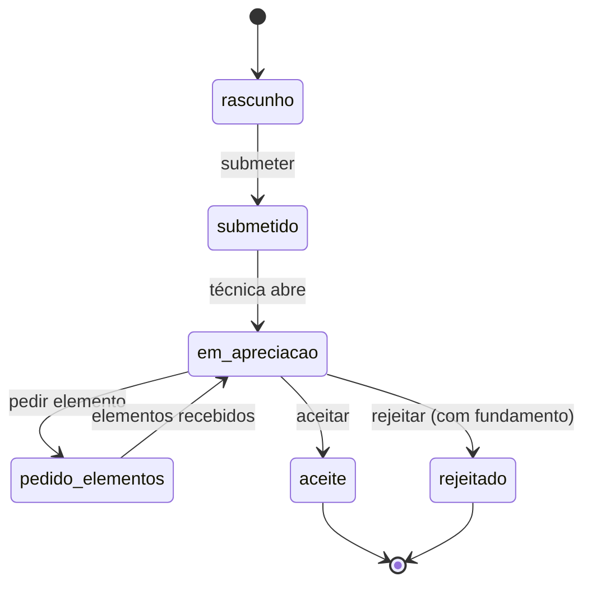

# 05 · Porta Agêntica e sistemas simulados

> Estado: proposta para discussão · Atualizado: 18/10/2026 · [Estratégia](README.md)
> Complementa [13 · Porta Agêntica](../13-porta-agentica-api.md).

## 1. Princípios

1. **O Afonso é cliente da Porta, não dono dela.** Usa MCP através da rede, com uma chave de cliente, como qualquer terceiro.
2. **Os sistemas simulados só se alcançam pela Porta.** Nenhum agente tem credenciais dos sistemas.
3. **Cada capacidade tem dono, finalidade, mandato mínimo, efeito e recibo.**
4. **Tudo o que é simulado diz que é simulado**, incluindo nas respostas MCP (`"simulacao": true`).

## 2. Ferramentas MCP do protótipo

| Ferramenta | Tipo | Mandato | Sistema | Prioridade |
|---|---|---|---|---|
| `procurar_servicos` | leitura | — | Registo Canónico | M |
| `obter_servico` | leitura | — | Registo Canónico | M |
| `criar_rascunho_ocupacao` | ação | D2 | Serviços Urbanos (simulado) | M |
| `submeter_comunicacao_previa` | ação | D3 + token de confirmação | Serviços Urbanos (simulado) | M |
| `consultar_estado_processo` | leitura | D1 | Serviços Urbanos (simulado) | S |
| `responder_pedido_elementos` | ação | D3 | Serviços Urbanos (simulado) | S |
| `obter_referencia_pagamento` | ação | D2 | Tesouraria (simulada) | S |
| `verificar_mandato` | leitura | — | Núcleo | C |

O **token de confirmação** é emitido pela Mini App quando a Inês confirma com a Chave Móvel Digital (simulada). Sem ele, `submeter_comunicacao_previa` devolve `CONFIRMACAO_EM_FALTA`. Isto mostra no código que submeter exige um ato da pessoa.

## 3. Sistema simulado 1 · Serviços Urbanos (Ocupação do Espaço Público)

Representa o sistema de registo do Gabinete de Serviços Urbanos. É a **fonte do ato**: o processo e a decisão vivem aqui, não no Delegate.

### Estados do processo

### Interface (REST interna, só para a Porta e para a Consola)

| Método | Rota | Faz |
|---|---|---|
| POST | `/processos` | Cria rascunho (`criar_rascunho_ocupacao`) |
| POST | `/processos/{n}/submeter` | Submete (exige token de confirmação) |
| GET | `/processos/{n}` | Estado, histórico, elementos pedidos |
| POST | `/processos/{n}/elementos` | Junta elementos |
| POST | `/processos/{n}/decisao` | Decisão da técnica (só a Consola) |
| GET | `/processos?estado=…` | Fila para a Consola |

### Regras simuladas

- Número de processo no formato `OEP/2026/0001` (fictício).
- Taxa calculada pelo sistema com uma tabela **fictícia**, sempre devolvida com `"valor_ficticio": true`.
- Valida o corredor de peões ≥ 2,00 m a partir dos dados recebidos; se faltar a largura da fachada, a proposta da Consola sugere pedir o elemento.

### Ecrã de «sistema legado» (C)

Página simples, com aspeto de sistema antigo, que lista os processos. Mostra ao júri que o registo existe no sistema da Câmara e não só no Delegate.

## 4. Sistema simulado 2 · Tesouraria (referências de pagamento)

Emite referências de pagamento depois da aceitação. **Não há pagamentos**: o Afonso entrega a referência e o pagamento faz-se fora do chat (regra de autonomia responsável).

| Método | Rota | Faz |
|---|---|---|
| POST | `/referencias` | Recebe processo e valor; devolve entidade, referência e montante **fictícios** |

**Sabor legado (C):** responder em XML e exigir uma chave de API no cabeçalho. O adaptador da Porta converte para JSON. Mostra que a Porta normaliza sistemas heterogéneos.

## 5. Sistema simulado 3 (opcional) · Agenda municipal

Publica eventos como «Votação da revisão do PDM na Assembleia Municipal». O agente proativo subscreve e envia o alerta autorizado à Inês (J2).

Alternativa mais barata: um botão «Simular evento» na Consola. Prioridade C.

## 6. Dados fictícios

| Dado | Regra |
|---|---|
| Moradas | Fictícias ou genéricas («Rua […], Guimarães») |
| Números de processo e referências | Formato plausível, prefixo ou marca «SIM» |
| Taxas | Valores fictícios, sempre com «fictício (Simulação)» |
| Freguesias | Nomes reais permitidos para agregação; contagens sintéticas marcadas |
| Terrenos e PDM | Sem classificação de solo de parcelas reais |

## 7. Agente externo

Para a demo da Porta: um cliente MCP de uso geral configurado com o endereço da Porta e uma chave de cliente «externo-demo». Só tem acesso às ferramentas de leitura. Se pedir uma ação, recebe `MANDATO_EM_FALTA`, o que também é uma boa demonstração.

## 8. Página pública da Porta (S)

`/porta` na aplicação web: lista as ferramentas, os esquemas de entrada e saída, os códigos de erro ([13](../13-porta-agentica-api.md#5-erros)) e as últimas chamadas (anonimizadas). Serve de documentação e de prova de abertura.
